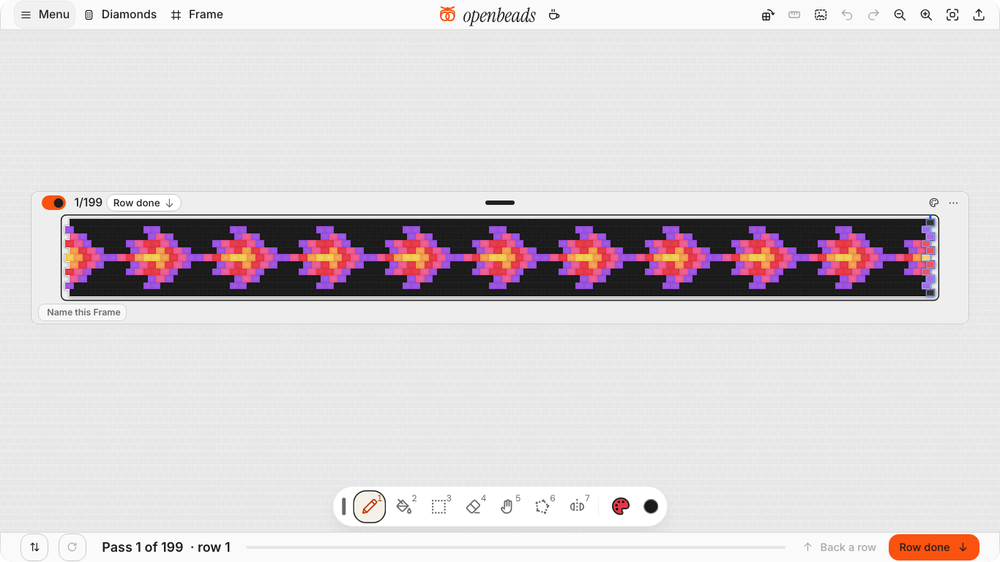

<div align="center">


# openbeads

**Bead patterns, drawn the way the beads sit.**

A free bead pattern maker for loom, peyote and brick stitch.<br>
It runs in your browser, works offline and keeps your work on your device.

<a href="https://openbeads.com"></a>
<a href="https://buymeacoffee.com/openbeads"></a>



</div>

openbeads is a pattern editor for people who weave with beads. You draw on a Canvas that has no edges, and each Technique shows its beads where they sit in the finished piece. Loom beads sit in a straight grid. Peyote and brick stitch beads sit staggered.

You can turn a photo into a pattern and pick colors by their Miyuki and TOHO codes. openbeads counts the beads you need of each color, and you mark rows done as you weave. It exports a PDF to print and a PNG to share.

Everything in openbeads is free. It has no account, no trial, no ads and no tracking.

One family makes openbeads. If it helps your work, you can support its development through [Buy Me a Coffee](https://buymeacoffee.com/openbeads).

**Open it at [openbeads.com](https://openbeads.com).** There is nothing to install. Your browser can also install openbeads as an app, and after the first visit it opens without a connection.

## Run it locally

You need Git and Node.js 22, the version CI runs.

```sh
git clone https://github.com/czAAA/bd-beads.git
cd bd-beads
npm ci
npm run dev
```

`npm run dev` prints a local address. The Homepage is at `/` and the editor is at `/app/`. The editor needs no backend, because it keeps every Project in the browser.

To use the production build, which includes the offline copy, run:

```sh
npm run build
npm run preview
```

The build reads the Version from the git history, so it fails in a shallow clone. Clone without `--depth`.

## What is inside

- **Canvas and Frame.** Draw anywhere on the Canvas. A Frame sets the size, the exports and the bead count.
- **Techniques.** Loom, peyote and brick stitch, each drawn the way its beads sit.
- **Editing.** Paint, fill, erase, select, copy, paste and undo. Every edit has its own key.
- **Mirror.** Draw one side and the other follows.
- **Convert image.** Turn a picture into a bead pattern.
- **Reference image.** Put a picture under the beads and draw a new piece over it.
- **Bead colors.** openbeads has the Miyuki and TOHO color codes built in, next to a Palette of your own.
- **Letters.** Each color has its letter, on the beads and on the chart.
- **Beads needed.** openbeads counts every color, in beads and in grams.
- **Row progress.** Mark rows done as you weave.
- **Exports.** A PDF to print, a PNG to share, a Word chart that writes the pattern out row by row, and the Project file.
- **Starters.** A ready design becomes your Frame.
- **Tablets and pens.** Pen mode, pen hover and buttons big enough for a finger, on iPad, Android and Windows.
- **Languages.** English, Russian, Ukrainian, Belarusian, Chinese, Spanish and Polish.
- **Themes.** Light, dark and high contrast, following the device.

Accounts, sync and View links are not open yet. Everything in this list works without them.

[CHANGELOG.md](CHANGELOG.md) lists every change a maker can see, by release.

## Works offline

openbeads is local-first. Every Project lives in the browser, so the app opens and works with no internet.

- The first visit needs the network once. After that a service worker serves openbeads from its cached copy, also when the hosting is down.
- A new version downloads in the background and shows "Update ready, Reload" in the open tab.
- Only what needs the backend stops, and openbeads says so with a message.
- Only a production build includes the service worker, so `npm run dev` never caches anything.

[docs/offline.md](docs/offline.md) says how to try it by hand and which decisions are behind it.

## How it is built

The app is Vue 3 and TypeScript, built with Vite. The backend is a Cloudflare Worker in `worker/`, with D1 and R2 for storage. Vitest runs the unit and component tests, and Playwright runs the browser checks.

| To learn | Read |
| --- | --- |
| The domain, its words and where to start in `src/` | [CONTEXT.md](CONTEXT.md) |
| Where code goes and the rules every change keeps | [CODING_STANDARDS.md](CODING_STANDARDS.md) |
| The design system | [DESIGN.md](DESIGN.md) |
| How tests are written | [docs/testing.md](docs/testing.md) |
| How the app reaches Cloudflare | [docs/deploy.md](docs/deploy.md) |

## Checks

| Command | What it checks |
| --- | --- |
| `npm run check` | Runs `npm run typecheck`, `npm run lint` and knip, which finds unused code. Run it before pushing |
| `npm run test:related -- <changed files>` | The unit and component tests related to a change, the browser component tests among them where Chromium is installed |
| `npm run test:full` | Runs `npm test`, the whole unit suite: the unit and component tests, the browser component tests where Chromium is installed (What's inside's whole tours among them) and the backend Worker's tests. It skips itself on a slow machine, where CI runs the suite |
| `npm run visual` | The [visual check](docs/testing/visual-check.md). Playwright draws fixture Projects in Chromium and compares the grid with reference screenshots. The first run needs `npx playwright install chromium` |
| `npm run perf` | The [performance check](docs/testing/performance-check.md). It prints frames per second and main-thread time at a CPU slowdown. Run it by hand on an idle machine |

CI runs typecheck, lint, the unit tests and the visual check on every pull request to `main`. [docs/testing/ci.md](docs/testing/ci.md) lists the required checks.

## Contributing

Issues are welcome. [Open an issue](https://github.com/czAAA/bd-beads/issues/new/choose) for a bug or an idea.

The project does not accept pull requests from outside yet. [CONTRIBUTING.md](CONTRIBUTING.md) will say when that changes.

Report a security problem privately, the way [SECURITY.md](SECURITY.md) describes.

## Ticket and ADR numbers

This repository is named `bd-beads`. The app it builds is openbeads.

The code and the docs cite tickets and architecture decision records by number, such as `ticket 69` and `ADR 0045`. Those live in a private repository, `czAAA/bd-beads-docs`, together with the specs and the research. This repository holds the code only, and it builds, lints and tests without the private one.

Maintainers clone the private repository next to this checkout and link it in:

```sh
git clone git@github.com:czAAA/bd-beads-docs.git ../bd-beads-docs
bash scripts/link-docs.sh
```

`link-docs.sh` creates gitignored symlinks: `.scratch`, `docs/adr`, `docs/research`, `docs/specs`, `docs/operations.md`, `reports` and `research_notes`. Tickets, ADRs and the operations runbook keep their paths that way. The script is safe to run again, and it refuses to replace a real folder. To move a machine from the old single-repo checkout, run `bash scripts/migrate.sh`.

## License

Copyright (C) 2026 czAAA. See [NOTICE](NOTICE).

openbeads is open source under the GNU Affero General Public License, version 3.0 or later. See [LICENSE](LICENSE).

The license is the AGPL because openbeads is served to its users, not distributed to them. Section 13 of the AGPL requires whoever hosts a modified copy as a service to offer its users the modified source. A permissive license or the GPL would not require that.

You may build, run, change and host openbeads under those terms. A fork sets its own support link in `src/data/coffeeLink.ts` and `.github/FUNDING.yml`.
